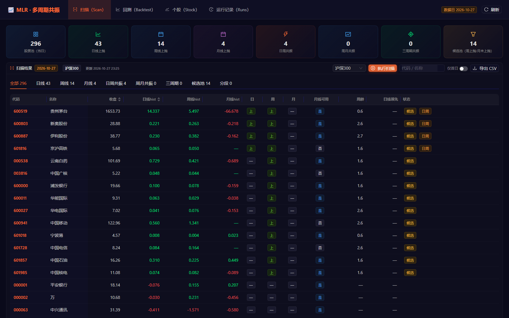
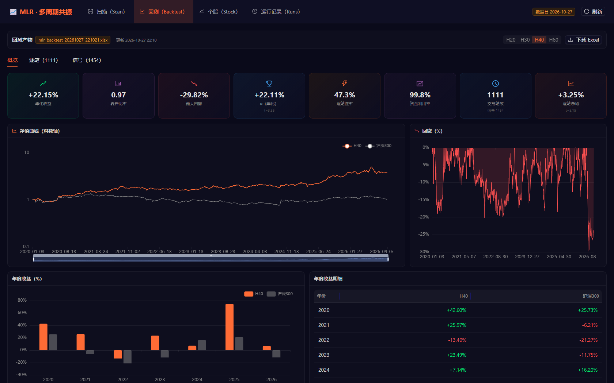

# ai_multi_level_resonance（MLR）· 多周期共振量化选股与回测

以 **MACD(30, 89, 9)** 的「上抛」形态为唯一判定内核，分别在 **日线 / 周线 / 月线** 上判断
趋势是否处于上抛中，再用「三周期共振」把它们串成买入信号、盘后扫描与历史回测。

工程内含四块内容：

| 模块 | 说明 | 入口 |
|---|---|---|
| **MLR 主工程** | 日/周/月三周期上抛判定 + 共振信号 + 盘后扫描 + 历史回测 + Excel/净值报告 | `scan.py` / `backtest.py` / `mlr/` |
| **MLR Web UI** | React 18 + Vite + AntD5(暗色) + ECharts 前端，FastAPI 后端：扫描/回测/个股/运行记录四个页面 | `webui/` |
| **MA7 上抛系统** | 另一套独立口径（MA7 斜率圈段 + 连续 N 根站上 MA7），日线 / 周线 / 日周共振扫描 + 轻量 Web UI | `ma7_system/` |
| **历史归档** | 早期形态实验（burst / coil / squeeze / launch / pattern 等） | `_archive_20261023/` |

> ⚠️ 本仓库是**量化研究代码**，所有数字均为历史回测/统计结果，不构成任何投资建议。
> 数据依赖本地 MySQL 与外部数据工程 `ai_backtest_model`，**不含行情数据**，见下文「数据准备」。

## 核心规则

规则全文（含参数逐条说明、验证记录）见 **[`doc/多周期上抛规则.md`](doc/多周期上抛规则.md)**；
参数唯一来源是 **[`config/resonance.json`](config/resonance.json)**（缺项自动回落到 `mlr/settings.py` 的 `DEF`）。

**单周期「上抛」**（逐根 K 线独立判定，只用截至当前 K 线的数据，无未来函数）：

| 周期 | 判定方法 | 要点 |
|---|---|---|
| 日线 | `hole_cross` | 「挖坑 → 起爆」：死叉后绿柱挖坑，零轴附近金叉、红柱连续放大 |
| 周线 | `parabola` | 对 DIF 最近 `fit_window` 根做二次拟合，要求 `a>0`、末端斜率上行、顶点在窗口左侧、`r²` 与相对曲率达标、DEA 同步上行、红柱连放 |
| 月线 | `parabola` | 与周线同构，窗口更短；`warmup_mult=1.0`（89 根，2023-02 起月线才可用） |

**共振与入场**（`signal.mode`，默认 `phase_wm`）：

- `phase_wm` — 按个股 `monthly_ready` 分段：月线暖机未完成 → 只做日 + 周共振；完成后 → 做周 + 月共振；
- `any_entry` — 日 + 周 + 月三周期共振首日；`wm_first` / `dw_first` — 周月 / 日周共振首日；
- `fresh_daily` — 日线金叉后 N 根内；`slowest_turn` — 月线刚转多当日；`dw_watch` — 日线先动候选。

**周期口径**：`data.period_mode=closed`（默认）只认**已收盘**的周/月 K（名义周期末 ≤ 当日），
保证 `scan.py` 与 `backtest.py` 完全一致；`asof` 用进行中周期（更灵敏，但回测无法复现，回测会自动回落 closed）。

## 目录结构

```
ai_multi_level_resonance/
├─ scan.py                  # 盘后扫描：最新交易日有哪些共振/单周期上抛个股
├─ backtest.py              # 回测主入口：信号 → 净值/绩效 → Excel + PNG + TXT
├─ requirements.txt         # 主工程依赖
├─ mlr/                     # 模型库（唯一实现）
│  ├─ settings.py           #   路径 / 数据源定位（ABM_ROOT）/ 参数加载与校验
│  ├─ data.py               #   日线拉取（MySQL）+ 增量同步 + 周/月重采样
│  ├─ macd.py               #   EMA / MACD(30,89,9)，与 ABM 逐位一致
│  ├─ resonance.py          #   上抛判定 + 三周期共振面板 + 信号提取  ★核心
│  ├─ ma7slope.py           #   MA7 斜率圈段（MA7 系统共用）
│  ├─ backtest.py           #   撮合、成本、涨跌停可成交性、绩效指标
│  ├─ report.py             #   Excel 多 Sheet / 净值图 / 文本汇总
│  └─ universe.py           #   股票池（沪深300 / 动力煤）
├─ config/
│  ├─ resonance.json        #   所有参数（周期、MACD、阈值、模式、回测口径）
│  ├─ hs300_constituents.json
│  └─ coal_constituents.json
├─ doc/多周期上抛规则.md      # 规则全文
├─ output/                  # 扫描 / 回测产物（xlsx、csv、png、txt；xlsx 不入库）
├─ data/_cache/             # 日线 parquet 缓存（约 145MB，不入库）
├─ webui/                   # MLR Web UI（详见 webui/README.md）
└─ ma7_system/              # MA7 上抛系统（详见 ma7_system/README.md）
```

## 环境与数据准备

### 1) Python 依赖

```powershell
pip install -r requirements.txt          # 主工程：pandas/numpy/pymysql/pyarrow/openpyxl/xlsxwriter/matplotlib
pip install -r webui\requirements.txt    # Web UI 后端：fastapi/uvicorn（Web UI 用）
node -v; npm -v                          # 仅 Web UI 前端需要 Node
```

### 2) 数据源：复用 `ai_backtest_model`（本仓库**不含**行情数据）

`mlr/settings.py` 通过环境变量 `ABM_ROOT` 定位外部数据工程（默认 `F:\ai_backtest_model`）：

```powershell
setx ABM_ROOT "D:\path\to\ai_backtest_model"     # 改到自己的路径后重开终端
```

它用到的 ABM 能力：

| 用途 | 来源 |
|---|---|
| 日线（后复权真源表） | ABM `.env` 的 `TABLE_BACKWARD_DAILY`（默认 `backward_tdx_daily`），经 `ABM.get_db_config()` 走 MySQL |
| 月线历史（可选，`monthly_history=true` 时） | `TABLE_BACKWARD_MONTHLY` |
| 沪深300 基准 | ABM `data/idx_000300.pkl` |
| EMA / 指标口径 | ABM `backtest_model.factors.indicators.calc_ema`（EMA 递推 `y0=x0`，逐位一致） |

> 周线 / 月线**不落库**，由日线重采样生成（`W-FRI` / `ME`），因此能更新到最新交易日。
> 首次运行会把日线落到 `data/_cache/daily_px.parquet`，之后 `--refresh` 才重拉；
> `scan.py` 启动时会自动 `sync_latest_daily` 增量同步到数据库最新日期。

### 3) 股票池

- `hs300`：`config/hs300_constituents.json`（`{"update_date": "...", "constituents": [...]}`）；
- `coal`：`config/coal_constituents.json`（手工整理的动力煤板块）；
- `all`：全市场。

> 成分股是「当前最新一期」快照：盘中/盘后扫描当天无偏差，但**历史回测会引入幸存者偏差**，
> 报告里应显式标注 `update_date`。

## 快速开始

### 盘后扫描（今日有没有共振买点）

```powershell
python scan.py                          # 最新交易日，默认 signal.mode=phase_wm
python scan.py --date 2026-10-16        # 指定交易日
python scan.py --recent 10              # 附带最近 10 个交易日信号
python scan.py --all-state              # 当日「处于共振中」的全部（含非首日）
python scan.py --layer daily            # 单周期：daily / weekly / monthly
python scan.py --layer dw               # 日线+周线共振
python scan.py --layer wm               # 周线+月线共振
python scan.py --layer watch            # 候选池：周线已上抛、月线未上抛
python scan.py --layer all              # watch / wm / entry 各存一份 CSV
python scan.py --universe all           # 全市场（hs300 / coal / all）
python scan.py --mode any_entry         # 三周期共振首日
```

### 历史回测

```powershell
python backtest.py                      # 默认沪深300、持有期 20/30/40/60、主口径 H40
python backtest.py --horizons 40        # 只跑 H40
python backtest.py --exec close_close   # 换执行口径（默认 open_open：信号日收盘确认、次日开盘执行）
python backtest.py --cost 0.003         # 双边成本
python backtest.py --limit 300          # 冒烟：只跑前 300 只
python backtest.py --codes 600188,000001
python backtest.py --refresh            # 强制重拉日线缓存
```

回测默认口径（见 `config/resonance.json` → `backtest`）：`open_open`、双边成本 0.2%、
按板块分档涨跌停（主板 9.7% / 创业板科创板 19.7%）、固定持有期（`exit=null`）、
起点 `2020-01-01`（面板与信号同一起来点，避免空仓期稀释年化/夏普/α）。

### 产物

| 路径 | 内容 |
|---|---|
| `output/scan_*.csv` | 扫描结果（`utf-8-sig`，Excel 直接打开不乱码） |
| `output/mlr_backtest_*.xlsx` | 多 Sheet：绩效、净值+回撤、年度收益、持有期对比、逐笔明细、共振信号 |
| `output/mlr_backtest_*.txt` | 文本汇总（口径、指标、分年统计） |
| `output/charts/mlr_nav_*.png` | 净值/回撤图 |

> `*.xlsx` 与 `data/_cache/*.parquet` 体积大，已在 `.gitignore` 中排除；仓库只保留小的
> `*.csv` / `*.txt` 结果作为样例。

## Web UI（MLR）

React 18 + Vite + Ant Design 5（暗色）+ ECharts 5 前端，FastAPI 后端；四个页面：
**扫描 / 回测 / 个股 / 运行记录**（股票池可切 沪深300 / 全市场 / 动力煤，页面内可直接「执行扫描」）。

```powershell
# 一键：需要时自动 npm install + build，然后打开 http://127.0.0.1:8200
powershell -ExecutionPolicy Bypass -File webui\start.ps1
```

手动方式：

```powershell
python -m uvicorn webui.backend.main:app --host 127.0.0.1 --port 8200   # 生产：直接托管 dist
cd webui\frontend; npm install; npm run dev                            # 开发：:3200，/api 代理到 :8200
python webui\export_scan.py --universe hs300                           # 手动重建扫描快照
```




页面细节、API 列表、快照文件说明见 **[`webui/README.md`](webui/README.md)**。

## MA7 上抛系统（独立口径）

`ma7_system/` 是另一套判定（MA7 的 5 周期斜率圈段 + 价格连续 3 根站上 MA7 确认，
C 主 + B 兜底，每段只取最早一个信号），三个入口：日线、周线、**日线 × 周线共振**
（日线开仓只允许在周线上抛段内）。日线数据复用本工程 `mlr.data` / `mlr.universe`。

```powershell
cd ma7_system
python ma7_scan_close3.py --universe hs300     # 日线
python ma7_scan_week.py   --universe hs300     # 周线（W-FRI，只用已收盘周）
python ma7_scan_res.py    --universe hs300     # 日线 × 周线共振
run_ma7_scans.bat                              # 一键：日线 + 周线 + 共振（沪深300）
start_web_ui.bat                               # 轻量 Web UI，默认 http://127.0.0.1:8770/
```

规则、参数、输出格式、周线周期筛选见 **[`ma7_system/README.md`](ma7_system/README.md)**。

## 配置速查（`config/resonance.json`）

| 键 | 默认 | 说明 |
|---|---|---|
| `universe.default` | `hs300` | 默认股票池（`hs300` / `coal` / `all`） |
| `data.start` | `2015-09-01` | 日线起点（与 ABM 日线表对齐） |
| `data.period_mode` | `closed` | 只用已收盘周/月 K；`asof` 用进行中周期（回测会回落 closed） |
| `macd` | `30 / 89 / 9` | **日/周/月统一**；日/周 `warmup_mult=2.0`，月线 `1.0` |
| `ma` | `7 / 21` | MA 快慢线 |
| `timeframes.daily.method` | `hole_cross` | 日线「挖坑→起爆」 |
| `timeframes.weekly/monthly.method` | `parabola` | 周/月抛物线形态（不看金叉死叉） |
| `filters` | `above_ma/ma_align = true` | 收盘在 MA 上方、均线多头排列 |
| `signal.mode` | `phase_wm` | 分段共振（月线暖机前 日+周，完成后 周+月） |
| `backtest` | `open_open, 0.2%, [20,30,40,60], H40, start=2020-01-01` | 回测口径 |

JSON 里的 `_xxx_note` 字段就是参数说明（含每个阈值为什么这么定的验证结论），改参数前建议先读。

## 关于本仓库

- **不含**：行情数据（MySQL / `ai_backtest_model` / `data/_cache/*.parquet`）、回测 Excel
  （`*.xlsx`）、`node_modules`、`__pycache__`、日志；这些都在 `.gitignore` 里。
- 首次运行前务必完成上面「环境与数据准备」两步，否则 `mlr.settings` 会报
  `找不到数据源工程 config.py`。
- 分支：`main`。两个远端镜像同步：
  - GitHub：https://github.com/baorui945/ai_multi_level_resonance
  - Gitee：https://gitee.com/paur19/ai_multi_level_resonance

```powershell
git push origin main    # GitHub
git push gitee  main    # Gitee
```

## 免责声明

本项目仅用于量化研究与技术交流，全部输出均为历史数据上的回测/统计结果，
不构成投资建议。实盘使用前请自行评估数据质量、交易成本、流动性与涨跌停等可成交性假设。

## 许可

未声明开源许可证（All rights reserved）。如需二次分发或商用，请先联系作者。

