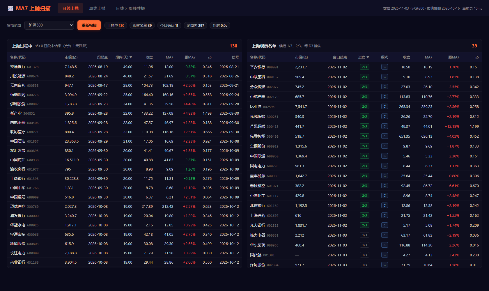

# ma7_system —— MA7「上抛」扫描（日线 v2 + 周线 + 共振）

同一套 v2 判定（MA7 斜率圈段 + 价格连续 N 根站上 MA7 确认），三个入口：

| 入口 | 做什么 | 周期 |
|---|---|---|
| `ma7_scan_close3.py` | 日线上抛扫描 | 日 |
| `ma7_scan_week.py` | 周线上抛扫描（同构） | 周（W-FRI） |
| `ma7_scan_res.py` | **日线 × 周线共振**：日线开仓只允许在周线上抛段内 | 日 + 周 |

> 本目录只有 v2 一套逻辑（C 主 + B 兜底，每段只取最早一个）；
> v1 日线、旧周/月线、旧日周共振（区间口径）已移入 `_archive_20261103/`。

## 目录结构

```
ma7_system/
├── ma7_scan_close3.py        # 日线扫描
├── ma7_scan_week.py          # 周线扫描
├── ma7_scan_res.py           # 日线×周线共振扫描
├── ma7daily/
│   ├── upthrow.py            # 段 / 信号 / 候选判定（日线、周线共用）
│   ├── resample.py           # 日线 → 周线（W-FRI）
│   ├── resonance.py          # 周线段提取 + 日期归属判断
│   └── settings.py           # 路径常量
├── config/ma7_close3.json    # 日线参数
├── config/ma7_week.json      # 周线参数
├── doc/日线扫描方案_v2.md     # 日线规则、参数、验证
├── output/                   # 扫描结果（运行时创建）
├── webapp/                   # Web UI（server.py + static/ + run_webapp.bat）
├── run_ma7_scans.bat         # 一键执行（日线 + 周线 + 共振，沪深300）
└── _archive_20261103/        # 旧逻辑归档（不参与运行）
```

## 一键执行

双击 `run_ma7_scans.bat`，依次跑：日线（近 5 日）→ 周线（近 3 周）→ 共振（当日）。

- 不带参数 = 沪深300；
- 带股票代码 = 只跑单票，例如 `run_ma7_scans.bat 000400`；
- 每次运行会先增量同步最新日线（失败时用本地缓存并告警）；
- 结束时列出三个 CSV 的命名规则与输出目录，窗口停住等回车。

## 日线扫描

```powershell
python ma7_scan_close3.py --universe hs300
python ma7_scan_close3.py --codes 000400 --date 2026-11-02 --recent 10
```

## 周线扫描

```powershell
python ma7_scan_week.py --universe hs300
python ma7_scan_week.py --codes 000400 --recent 10
```

周线只用**已收盘周**（`period_end <= 扫描日`）。

## 共振扫描（日线开仓必须在周线上抛段内）

```powershell
python ma7_scan_res.py --universe hs300
python ma7_scan_res.py --codes 600188 --date 2026-09-01
python ma7_scan_res.py --universe hs300 --recent 10
```

规则：

- 周线上抛段 = s5w 连续 2 周 > 0 启动，连续 2 周 <= 0 结束；段区间 = [段起点, 最后一个 s5w > 0 的周]；
- 日线信号（D3 收盘确认、D4 开盘执行）的**确认日 D3 必须落在周线段内**；
- 开仓日 D4 已知时也必须在段内（“只能在启动和结束之间开仓”）；
- 段仍在进行中（数据末端未出现连续 2 周 s5w ≤ 0）→ 段没有上界；
- 不满足 → 写入「不开仓」，不进买入清单。

输出会分两组列示：**今日确认 + 周线段内（可开仓）**、**今日确认但在周线段外（不开仓）**；
候选 1/3、2/3 也标了「段内 / 段外」。

## 规则摘要（日线 / 周线同一套）

- **段**：MA7 的 5 周期斜率 > 0，连续 2 根确认起止，允许 1 根回踩；段内价格从未站上 MA7 的斜率段跳过；
- **C（主）**：段内首次收盘 > MA7 起，连续 3 根收盘 > MA7；
- **B（兜底）**：C 未出信号时，前一根跌破、当根重新站上，连续 3 根；
- 每段只取**最早一个**信号，C 成功则不再找 B；
- **D1 候选 1/3 → D2 候选 2/3 → D3 收盘确认 → D4 开盘执行**。

| 项 | 日线 | 周线 |
|---|---|---|
| 周期 | 每个交易日 | W-FRI（该周最后交易日） |
| 段确认 | 连续 2 天 | 连续 2 周 |
| 信号确认 | 连续 3 天收盘 > MA7 | 连续 3 周收盘 > MA7w |
| D4 执行 | 次日开盘 | 下一周首个交易日开盘 |
| 参数 | `config/ma7_close3.json` | `config/ma7_week.json` |

## Web UI（日线 / 周线 / 共振）

```powershell
# 方式一：双击项目根目录的启动器（推荐）
start_web_ui.bat            # 默认 8770，4 秒后自动开浏览器
start_web_ui.bat 8788       # 也可指定端口

# 方式二：命令行
cd webapp
python server.py            # 默认 http://127.0.0.1:8770/
```

启动器做的事：检查 python → 检查端口是否已被占用（已占用就只开浏览器）→ 起服务 → 自动打开页面；**关掉那个黑窗口即停止服务**。

页面（暗色主题，对齐 realTimeTrade 的 AntD Dark 风格）：

- 四个页签：**日线上抛 / 周线上抛 / 日线 × 周线共振 / 周线周期**（「周线启动」是周期页里的筛选，不再是单独页签）；
- 扫描范围：沪深300、市值 ≥1000 亿、500–1000 亿、200–500 亿、100–200 亿、<100 亿
  （市值取 `factor_daily_basic.total_mv` 的最新快照，页面右上角标注快照日期）；
- 两张结果表：**上抛过程中**（段未结束，今日确认带「今确认」标签）/ **上抛观察名单**（候选 1/3、2/3）；
- 点顶部 **「今日确认 N」** 这个 chip → 上抛过程中只显示今日确认的个股，再点恢复全部；
- 每张表右上角都有 **「导出」**：只导出**这一张表**的股票代码（txt，一行一个、按当前排序），文件名 `ma7_<模式>_<范围>_<日期>_<up|watch>.txt`；筛选状态下只导出筛出来的那部分；
- 点任意一行：右侧抽屉显示**近 1 年 K 线 + MA7 + 成交量 + MACD(30,90,9)**
  （日线页签 = 日 K 250 根；周线页签 = **周 K 60 根**，指标按周计算；
  **共振页签上下两屏**：上日 K、下周 K，各自标注自己的段起点与信号），
  橙色虚线标出上抛段起点（周线页签标周线段起点），橙色三角标信号日；
- 深链接：`/?mode=weekly&code=000400`。



后端 `webapp/server.py` 只用 Python 标准库（http.server），前端 `webapp/static/` 为原生 JS + ECharts（本地文件，无需联网）。

### 扫描结果缓存（重启不用重算）

- 每个「模式 × 扫描范围」的扫描结果会写到 `webapp/.cache/<mode>_<scope>_<数据日期>_<市值快照>.json`；
- 下次启动服务时**直接读缓存**（约 0.05 秒），只有数据日期或市值快照变了才会重算；
- 页面耗时 chip 会显示「· 缓存」表示命中；
- 点「重新扫描」会清空磁盘缓存并重算；
- 想把所有组合一次算好：`python webapp\warm_cache.py`（可带范围参数，如 `hs300 mv200_500`）。

> 实测：日线/沪深300 冷算 4.0s → 重启后 0.05s；六个范围 × 五个模式预热后，任何页签切换都是即时。

## 周线周期性筛选（第四个页签）

对应 `ma7daily/cycle.py`，用来找「大波段很规整」的个股（类似 000400 那种周线正弦式来回）。

规则（全部基于**已收盘周**）：

1. 取最近 **156 周** 周线收盘，取对数后**去掉线性趋势**；
2. 在 **45–170 周** 的周期网格上做**正弦最小二乘拟合**，取 R² 最高的一档，得到：
   - **拟合 R²**：形态有多像正弦波（0~1）；
   - **周期(周)**：拟合出的周期长度；
   - **振幅**：去趋势后的峰谷幅度；
   - **净趋势**：3 年净涨跌幅，越小越像「来回走」；
   - **波谷位 pos**：拟合波当前位置（0=谷底，1=峰顶）；
3. 辅助：MACD(30,90,9) 的 DIF 穿越 0 次数；
4. **周期分** = R² 40 + 振幅 30 + 净趋势 15 + 周期合理度 8 + MACD 7。

结果分两档：**强周期股（≥76 且 R²≥0.55）** 与 **次级周期（70–76）**，按周期分排序；点任意一行看 **日 K + 周 K 双屏**（白线 MA7、黄线 MA21、MACD(30,90,9)）；其中**周 K 取全部历史**（本例 556 周，2015 年至今），自动缩到最小，并**把最新一根放在正中**（右侧补等长空白）。

> 沪深300 实测：297 只样本中强周期 36 只、次级 35 只；000400 许继电气 80.7 分（R² 0.78、周期 69 周、振幅 65.7%、净趋势 0.06）。

## 周线启动（周期页里的筛选）

对应 `ma7daily/cycle.py` 里的 `early` / `pre_start` 标记，用来抓「周期底部刚启动」的那几周。判定（全部逐周计算）：

| 条件 | 阈值 |
|---|---|
| 收盘上穿 MA21 | ≤ 12 周 |
| MACD(30,90,9) 柱由负转正 | ≤ 4 周 |
| 距 MA21 | ≤ +12%（还没走远） |
| 周期波谷位 pos（0=谷底，1=峰顶） | ≤ 0.55 |

在「周线周期」页点顶部 **「周线启动 N」** chip → 左边表格只显示强周期里触发启动的那几只，再点恢复全部；名字旁的「启动」= 上穿与翻红都满足，「初上穿」= 刚站上 MA21、MACD 柱还没翻红（次级表里也能看到）。

点任意一行 → **上日 K、下周 K** 双屏（都带 MA7、MA21、MACD(30,90,9)）。

> 沪深300 实测：强周期·启动 5 只（中航沈飞、牧原股份、中航成飞 + 海大集团、分众传媒「初上穿」），其他·启动 15 只。

## 输出

| 文件 | 内容 |
|---|---|
| `output/ma7_scan_close3_YYYYMMDD.csv` | 日线：confirmed / candidate2 / candidate1 |
| `output/ma7_week_scan_YYYYMMDD.csv` | 周线：同上（YYYYMMDD = 该周最后交易日） |
| `output/ma7_res_scan_YYYYMMDD.csv` | 共振：日线三桶 + 周线段信息 + 动作 |

共振 CSV 在日线列基础上增加：`wk_seg / wk_start / wk_end / wk_in / action / note`。

所有扫描都同时写同名 `.meta.json`（规则、配置、数据区间、计数、生成时间）。

## 数据与依赖

- 日线数据只读复用主工程 `mlr.data` / `mlr.universe`；
- 共享后复权日线缓存：`../data/_cache/daily_px.parquet`；
- 不修改主工程任何代码、配置或输出；
- 本系统输出全部写在 `ma7_system/output/`。

## 归档

旧逻辑（v1、旧周/月线、旧日周共振区间口径）在 `_archive_20261103/`，恢复方法见该目录 README。
