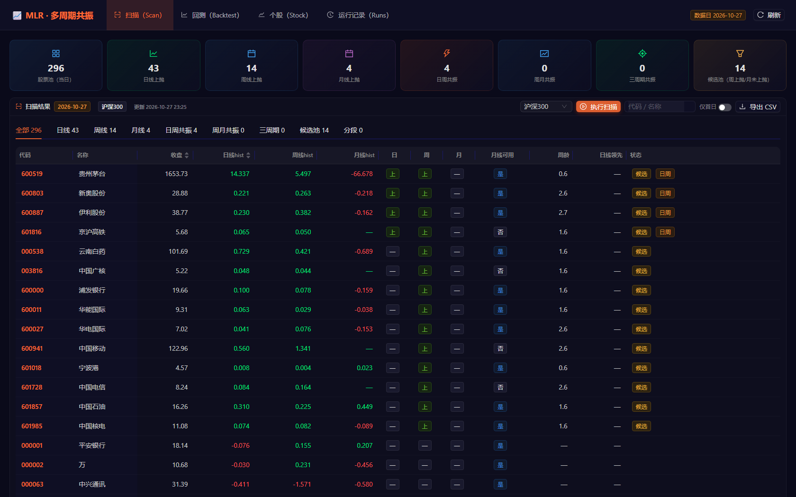
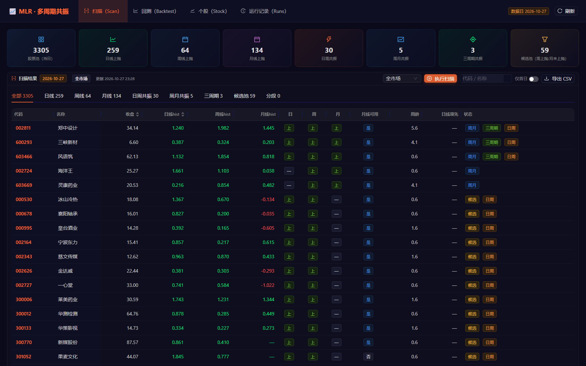
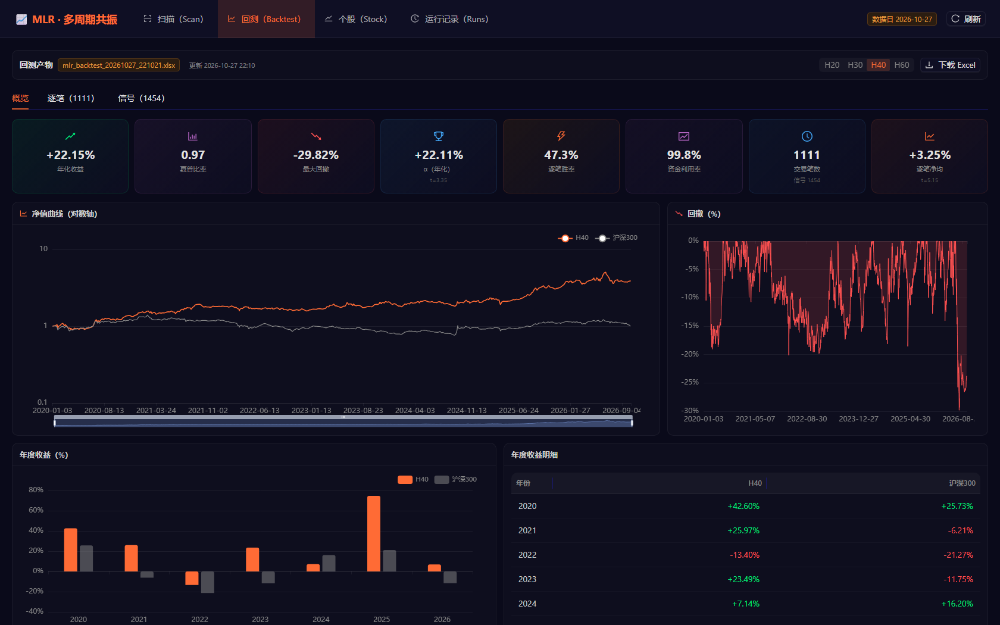
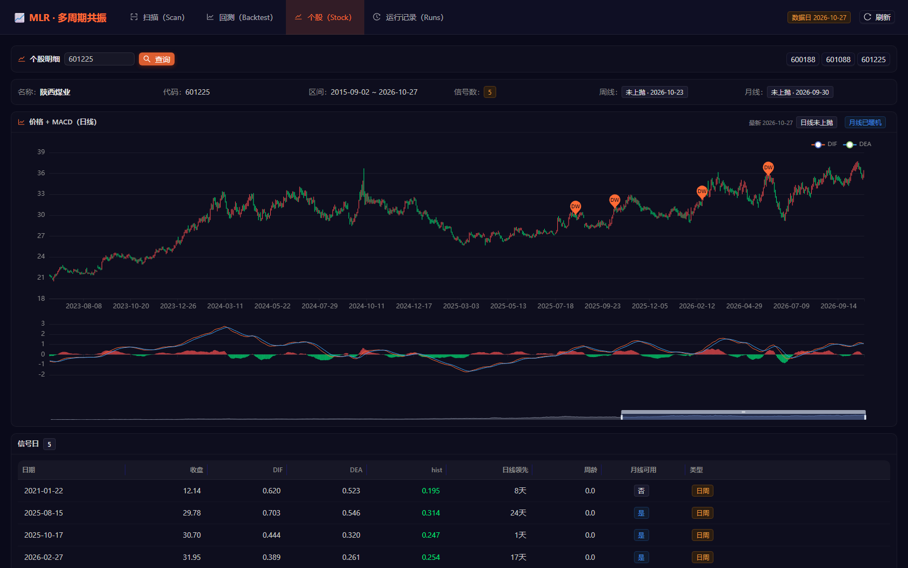
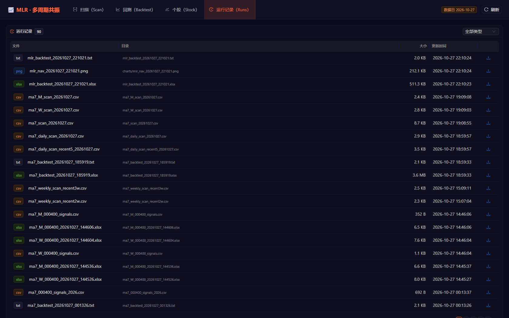

# MLR Web UI

本工程（`ai_multi_level_resonance`）的 Web 展示层，视觉与交互参考
`F:\realTimeTrade`：**React 18 + Vite 6 + Ant Design 5（暗色）+ ECharts 5**，
主色 `#FF6B35`、背景 `#0a0a1a`、容器 `#0f0f24`。

## 页面

| 页面 | 内容 |
|---|---|
| **扫描（Scan）** | 最新交易日全池扫描，**股票池**：沪深300 / 全市场 / 动力煤，**「执行扫描」按钮**（后台任务 + 自动刷新）；**场景 Tab**：日线 / 周线 / 月线 / 日周共振 / 周月共振 / 三周期 / 候选池 / 分段；每个场景可叠加「仅首日」；搜索、CSV 导出 |
| **回测（Backtest）** | 最新 `mlr_backtest_*.xlsx`：年化/夏普/回撤/α/胜率/利用率指标卡、净值+回撤、年度收益、持有期对比、逐笔明细、共振信号、Excel 下载 |
| **个股（Stock）** | 输入代码：K 线 + MACD、日周/分段信号标记、信号日明细、最近周线/月线状态 |
| **运行记录（Runs）** | `output/` 下的 xlsx / csv / png / txt 产物，按类型筛选、下载 |

### 扫描场景（页面 Tab 与 CLI 一一对应）

| 场景 | 页面 Tab | 状态字段 | CLI |
|---|---|---|---|
| 日线 | 日线 | `up_daily` | `python scan.py --layer daily` |
| 周线 | 周线 | `up_weekly` | `python scan.py --layer weekly` |
| 月线 | 月线 | `up_monthly` | `python scan.py --layer monthly` |
| 日线+周线共振 | 日周共振 | `dw_resonance` | `python scan.py --layer dw` |
| 周线+月线共振 | 周月共振 | `wm_resonance` | `python scan.py --layer wm` |
| 日+周+月 | 三周期 | `resonance` | `python scan.py --mode any_entry` |
| 周线已上抛、月线未上抛 | 候选池 | `watch` | `python scan.py --layer watch` |

> `--layer entry` 跟随 `signal.mode`（默认 `phase_wm`）；要三周期首日信号请用
> `--mode any_entry`。页面 Tab 的「三周期」显示的是 `resonance` 状态（含非首日），
> 叠加「仅首日」后才按 `entry` 过滤。

页面上的「仅首日」对每个场景使用各自的转折字段（`up_daily_turn` /
`up_weekly_turn` / `up_monthly_turn` / `dw_entry` / `wm_entry` / `entry` /
`watch_entry`），不是简单的“当天状态”。

### 股票池与手动扫描

页面右上角下拉选择股票池（**沪深300 / 全市场 / 动力煤**），点「执行扫描」：

* 请求 `POST /api/scan/run` 启动后台任务，页面每 2 秒轮询 `GET /api/scan/job/{id}`；
* **全市场**按 500 只/块分块计算（峰值内存可控），实测约 **2–5 分钟**；完成后自动
  重新加载当前股票池；
* 快照文件：`webui/data/scan_<universe>.json` + `scan_<universe>.meta.json`
  （hs300 额外复制一份 `scan_full.json` 兼容旧路径）；
* 同一时间只允许一个扫描任务，重复点击会返回 409。

CLI 等价操作：

```powershell
python webui\export_scan.py --universe hs300
python webui\export_scan.py --universe all        # 全市场，约 2-5 分钟
python webui\export_scan.py --universe coal
python webui\export_scan.py --universe all --date 2026-10-27
```

> 全市场扫描读的是本地 parquet 缓存（`data/_cache/daily_px.parquet`）；
> 数据更新请先跑 `scan.py`（会自动同步上游）或手动 `sync_latest_daily`。







## 启动

```powershell
# 一键：需要时自动 npm install + build，然后打开 http://127.0.0.1:8200
powershell -ExecutionPolicy Bypass -File webui\start.ps1
```

或手动：

```powershell
# 1) 后端（生产模式直接托管 dist）
python -m uvicorn webui.backend.main:app --host 127.0.0.1 --port 8200

# 2) 前端开发模式（可选，:3200，/api 代理到 :8200）
cd webui\frontend
npm install
npm run dev
```

## 数据从哪来

```
data/_cache/daily_px.parquet
        │  mlr.data / mlr.resonance
        ├─► webui/export_scan.py  ──► webui/data/scan_full.json   （扫描页）
        ├─► output/mlr_backtest_*.xlsx ──► /api/backtest           （回测页）
        └─► /api/stock/{code}（按需计算单只股票）                  （个股页）
```

* **扫描页**读取 `webui/data/scan_full.json`（全池当日全部行，含所有层标记）。
  数据更新后执行：

  ```powershell
  python webui\export_scan.py                 # 默认 hs300、最新交易日
  python webui\export_scan.py --universe all  # 全市场（内存/耗时更高）
  python webui\export_scan.py --date 2026-10-27
  ```

  也可以直接点页面右上角「刷新」：后端会调用该脚本重建快照（约 10–20 秒）。

* **回测页**读取 `output/` 下最新的 `mlr_backtest_*.xlsx`。跑完回测后点「刷新」：

  ```powershell
  python backtest.py --horizons 20,30,40,60
  ```

* **个股页**按需从 parquet 缓存计算（`mlr` 全流程，单只约 1–2 秒），带进程内缓存。

## API

| 方法 | 路径 | 说明 |
|---|---|---|
| GET | `/api/health` | 健康检查 |
| GET | `/api/meta` | 扫描/回测产物元信息、数据日、各股票池快照 |
| GET | `/api/scan?universe=hs300\|all\|coal` | 指定股票池的扫描快照（行 + 各层计数） |
| POST | `/api/scan/run` | 手动执行扫描（body: `{universe, date?}`），返回 job |
| GET | `/api/scan/job/{id}` | 扫描任务状态（running / completed / failed） |
| GET | `/api/backtest` | 回测绩效/净值/年度/逐笔/信号 |
| GET | `/api/stock/{code}` | 个股日/周/月明细与信号 |
| GET | `/api/runs` | `output/` 产物列表 |
| GET | `/api/download/{rel}` | 下载 `output/` 内文件（路径白名单） |
| POST | `/api/refresh` | 清缓存并重新读取（默认不重跑扫描） |

## 目录

```
webui/
├─ backend/
│  ├─ main.py          # FastAPI 入口 + 静态托管
│  └─ data_store.py    # 产物解析 / 个股计算 / 缓存
├─ frontend/
│  ├─ src/App.tsx      # 顶栏 + 四个页面（hash 路由 #/scan 等）
│  ├─ src/pages/       # Scan / Backtest / Stock / Runs
│  ├─ src/components/  # MetricCard / ECharts option
│  └─ dist/            # 构建产物（npm run build）
├─ export_scan.py      # 生成 scan_full.json
├─ data/scan_full.json # 扫描快照
├─ start.ps1 / start.bat
└─ README.md
```

## 说明

* 扫描快照默认 **hs300**（与回测默认股票池一致）；`--universe all` 会构建
  全市场共振面板（约 700 万行），内存占用较高，建议单独跑。
* 回测页展示的是**最新一个 xlsx**；文件里的 mode/口径由生成它的命令决定
  （文件名与页头会显示）。当前默认 `signal.mode=phase_wm`。
* 所有颜色、卡片、表格样式集中在 `frontend/src/styles/global.css`，
  与 `F:\realTimeTrade\frontend\src\styles\global.css` 同一套 token，改主题只需
  改 `App.tsx` 的 `ConfigProvider` 和该 CSS。
